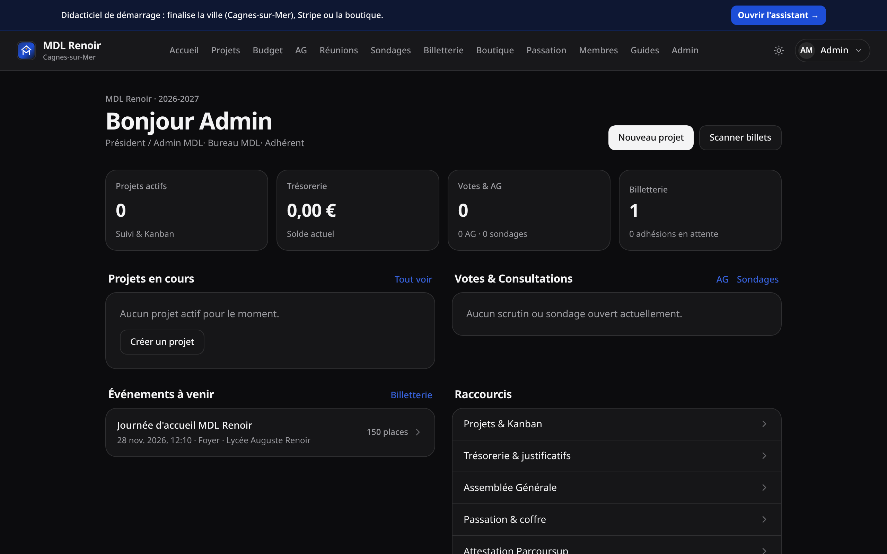
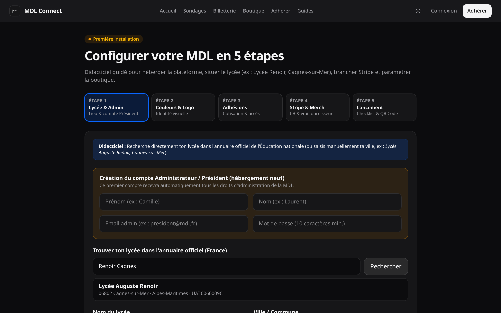
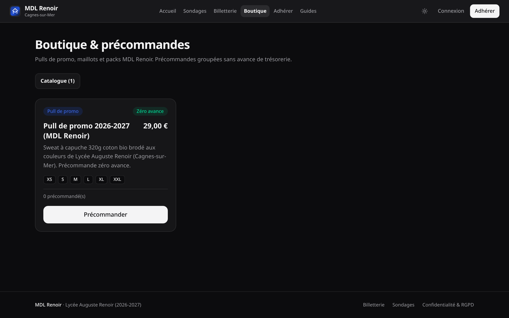

<div align="center">
  
  <h1>MDL Connect</h1>
  <p>
    <strong>Plateforme tout-en-un auto-hébergeable pour les Maisons des Lycéens (Loi 1901)</strong><br />
    Didacticiel d'installation <code>/setup</code>, boutique zéro-avance avec vrais fournisseurs, billetterie QR Ed25519 hors-ligne, réunions, AG, Stripe & coffre-fort RGPD.
  </p>
  <p>
    
    
    
    
    
  </p>
</div>

<p align="center">
  
</p>

| Didacticiel 1re installation (`/setup`) | Boutique zéro-avance & précommandes |
| :---: | :---: |
|  |  |

---

## Points clés

- **Didacticiel `/setup` (auto-hébergement guidé)** : dès le premier démarrage sur une base vierge, création du compte Administrateur/Président, recherche directe du lycée dans l'**annuaire officiel de l'Éducation nationale (`data.education.gouv.fr`)**, choix des couleurs/logo, cotisation, clés **Stripe CB**, fournisseur textile et **QR Code d'adhésion `/adhesion`**.
- **Boutique zéro-avance & vrais fournisseurs** : aucune usine imposée ni commission plateforme. Renseignez votre propre imprimeur/brodeur (`merchSupplierName`, `merchSupplierEmail`, `merchSupplierUrl`, `supplierReference`), collectez les précommandes `XS→XXL` puis générez le **bon de commande consolidé** (`mailto:` pré-rempli + export CSV).
- **Billetterie QR signée Ed25519 hors-ligne** : scan caméra temps réel via WebAssembly Rust (`crates/mdl-wasm`) sans connexion requise à l'entrée.
- **Vie associative complète** : Projets & Kanban, Trésorerie & justificatifs chiffrés, Réunions (ordre du jour, émargement, PV PDF), Assemblées Générales (quorum + votes), Sondages temps réel, Passation & Accord établissement PDF, Attestation Parcoursup PDF, Rôles RBAC dynamiques.
- **Sécurité & RGPD** : chiffrement **AES-256-GCM** au repos, clés Stripe chiffrées en base, journal d'audit chaîné **SHA-256**, PWA installable iOS/Android.

---

## Démarrage rapide (Docker + `/setup`)

```bash
git clone https://github.com/ybenyedder/mdl-app.git
cd mdl-app
chmod +x scripts/install.sh
./scripts/install.sh
```

Ouvrez ensuite **`http://<ip-serveur>:3400/setup`** pour créer votre compte Président, localiser votre lycée (ex. *Lycée Auguste Renoir, Cagnes-sur-Mer*) et configurer l'ensemble de la plateforme en 5 étapes.

---

## Architecture & développement local

```text
mdl-app/
├── apps/web/                 # SvelteKit 2 + Svelte 5 + Tailwind v4 + Drizzle PostgreSQL 17
├── crates/mdl-wasm/          # Module Rust WebAssembly (Ed25519 QR offline, graphiques SVG)
├── docs/                     # Logo, captures Dark Mode & guides d'exploitation / RGPD
├── scripts/                  # install.sh, sauvegarde GPG chiffrée, restore & update
└── docker-compose.yml        # PostgreSQL 17 + App + Backups + Uptime Kuma
```

```bash
cd apps/web
pnpm install --frozen-lockfile
npm run check        # svelte-check + TypeScript
npm run test:unit    # Vitest + PostgreSQL PGlite en mémoire
DATABASE_URL="pglite://memory" npm run dev
```

## Documentation

- [Guide de déploiement débutant](./docs/DEPLOIEMENT_DEBUTANT.md) · [Administration](./docs/ADMIN.md) · [Utilisation](./docs/UTILISATION.md)
- [Sécurité & RGPD](./docs/SECURITE_RGPD.md) · [Matrice RBAC](./docs/MATRICE_PERMISSIONS.md) · [Passation](./docs/PASSATION.md)
