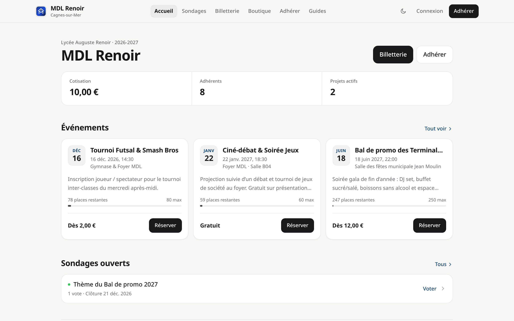
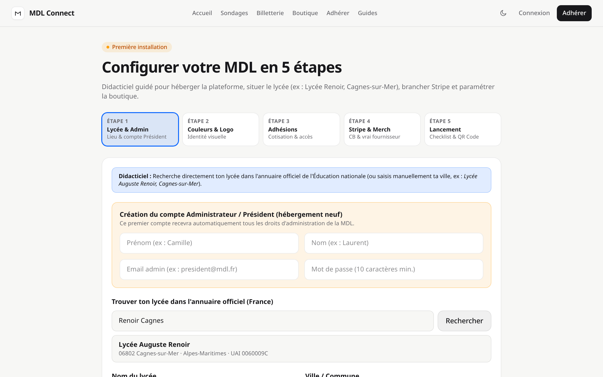
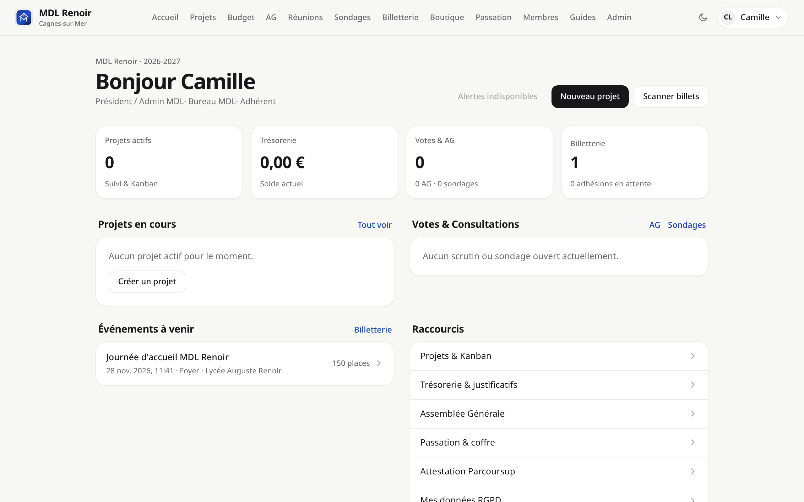
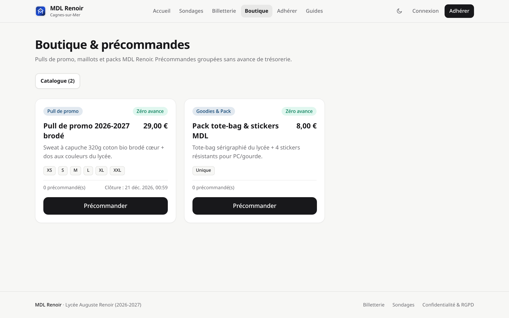
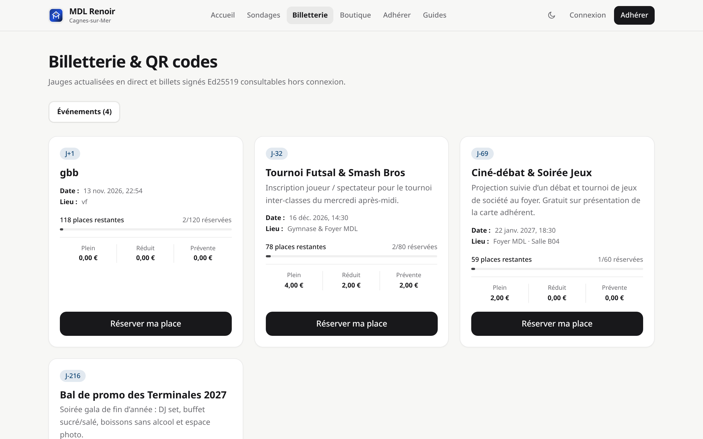
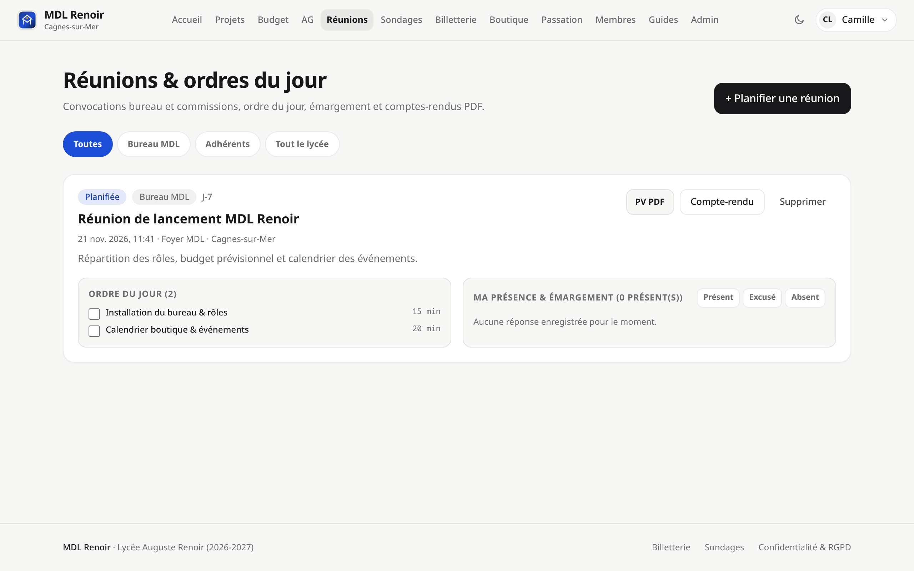
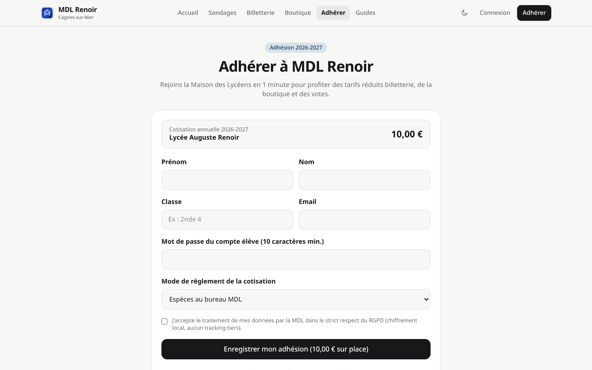
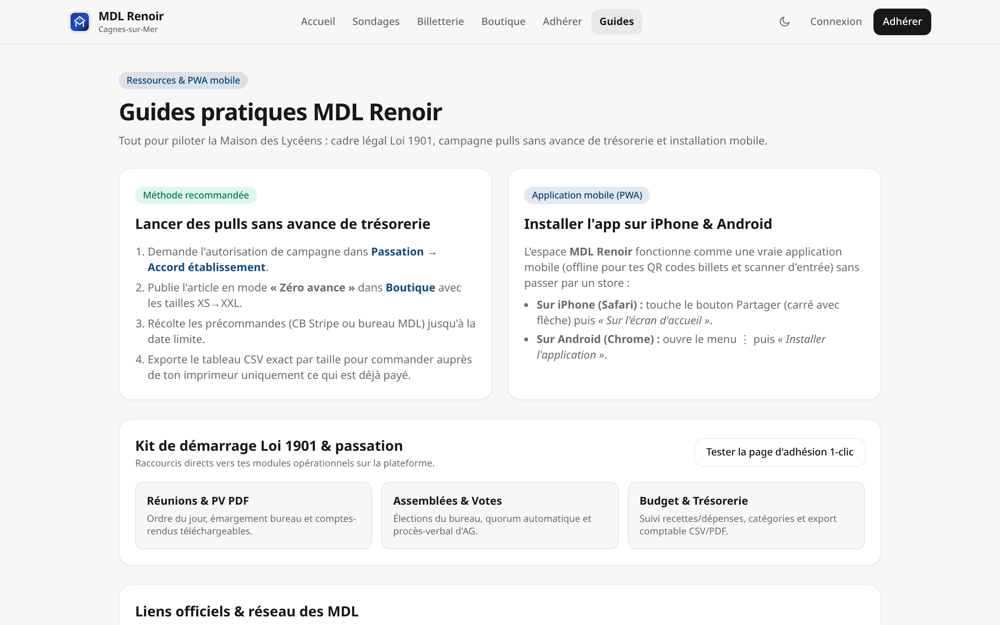

<div align="center">
  
  <h1>MDL Connect</h1>
  <p>
    <strong>Plateforme tout-en-un auto-hébergeable pour les Maisons des Lycéens (associations loi 1901)</strong><br />
    Gestion de projets, trésorerie, AG, réunions, boutique zéro-avance avec fournisseurs réels, billetterie QR signée Ed25519 hors-ligne, adhésions 1-clic et didacticiel de mise en route.
  </p>
  <p>
    
    
    
    
    
    
  </p>
</div>

---

## Pourquoi MDL Connect ?

**MDL Connect** remplace les tableurs épars, formulaires jetables et services à commissions par une **application web installable (PWA)** hébergée par l'établissement ou la MDL :

- **Zéro commission plateforme & liberté fournisseur** : la billetterie et la boutique passent directement par le compte **Stripe** de la MDL (ou en espèces/virement au foyer), avec export direct des **bons de commande vers votre vrai imprimeur textile**.
- **Installation guidée (`/setup`)** : dès le premier lancement sur un serveur neuf, un didacticiel en 5 étapes permet à l'administrateur de créer son compte Président, localiser le lycée dans l'**annuaire officiel de l'Éducation nationale**, brancher Stripe et préparer la boutique.
- **Sécurité & RGPD natifs** : données personnelles chiffrées en AES-256-GCM, journal d'audit chaîné SHA-256 infalsifiable, billets QR signés **Ed25519** vérifiables **sans connexion internet** grâce au module Rust WebAssembly (`crates/mdl-wasm`).

---

## Captures d'écran

| Accueil public | Assistant `/setup` (1re installation) |
| :---: | :---: |
|  |  |

| Tableau de bord Administrateur | Boutique & précommandes (XS→XXL) |
| :---: | :---: |
|  |  |

| Billetterie Ed25519 | Réunions, émargement & PV PDF |
| :---: | :---: |
|  |  |

| Adhésion directe 1-clic | Guides pratiques & Ressources MDL |
| :---: | :---: |
|  |  |

---

## Boutique & vrais fournisseurs textiles : comment ça marche ?

MDL Connect **n'intègre pas d'usine d'impression interne** et ne prélève aucune marge cachée. À la place, la boutique applique la méthode **« Zéro avance de trésorerie »** compatible avec **n'importe quel vrai imprimeur/brodeur local ou atelier Print-on-Demand français** :

1. **Renseignez votre vrai fournisseur** dans `/setup` ou `/admin/parametres` (`merchSupplierName`, `merchSupplierEmail`, `merchSupplierUrl`), ainsi que par article (`supplierReference` ex. `HOODIE-BIO-320G`).
2. **Ouvrez les précommandes (XS → XXL)** sur `/boutique` avec paiement CB Stripe direct, virement ou espèces au foyer.
3. **À la clôture de la campagne**, cliquez sur **« Préparer le bon de commande fournisseur »** : l'application consolide automatiquement les quantités payées par taille, génère un bon de commande prêt à copier, un **lien `mailto:` pré-rempli** vers l'email du fournisseur et un **export CSV complet**.

---

## Installation & auto-hébergement (Docker + Didacticiel `/setup`)

### Prérequis

- Un serveur Linux (VPS, Raspberry Pi, serveur du lycée) avec **Docker** et **Docker Compose**.

### 1. Cloner et lancer les conteneurs

```bash
git clone https://github.com/ybenyedder/mdl-app.git
cd mdl-app
chmod +x scripts/install.sh
./scripts/install.sh
```

> Le script génère automatiquement vos secrets cryptographiques (`ENCRYPTION_KEY`, `HMAC_SECRET`, `TICKET_JWT_SECRET`, `TICKET_ED25519_*`, clés VAPID Push), initialise la base **PostgreSQL 17**, exécute les migrations Drizzle et démarre l'application sur le port **`3400`**.

### 2. Configurer le lycée via le Didacticiel `/setup`

Ouvrez **`http://<IP-de-votre-serveur>:3400/setup`** dans votre navigateur :

1. **Étape 1 — Admin & localisation officielle** : sur une base vierge, créez directement le premier compte **Administrateur / Président**, puis recherchez votre établissement dans l'annuaire `data.education.gouv.fr` (ex. *Lycée Auguste Renoir, Cagnes-sur-Mer*) pour remplir automatiquement nom, ville, code postal, département et code UAI.
2. **Étape 2 — Identité visuelle** : choisissez la palette et le logo du foyer.
3. **Étape 3 — Adhésions & accès** : montant de cotisation annuelle et mode d'inscription (`Ouvert`, `Code secret lycée` haché HMAC, ou `Sur invitation`).
4. **Étape 4 — Stripe CB & Fournisseur textile** : didacticiel pas-à-pas pour copier vos clés `pk_...`, `sk_...` et `whsec_...` depuis le Dashboard Stripe (chiffrées AES-256-GCM en base), et renseigner votre atelier textile.
5. **Étape 5 — Lancement & QR Code** : génération optionnelle d'un kit de démarrage (pull de promo, journée d'accueil, réunion de bureau) + **QR Code prêt à imprimer** pointant vers `/adhesion`.

L'assistant reste réouvrable à tout moment depuis **Admin → Paramètres (`/admin/parametres`)**.

---

## Modules inclus

| Module | Route | Fonctionnalités clés |
| :--- | :--- | :--- |
| **Accueil & Stats** | `/` | Prochains événements, sondages ouverts, cotisation et identité du lycée |
| **Setup & Didacticiel** | `/setup` | Bootstrap 1er Admin, annuaire Éducation nationale, presets couleurs, Stripe, QR d'adhésion |
| **Boutique & Précommandes** | `/boutique` | Tailles `XS→XXL`, mode zéro avance, bon de commande fournisseur consolidé (`mailto:` + CSV) |
| **Billetterie & Scanner** | `/billetterie`, `/billetterie/scanner` | Billets QR Ed25519 + JWT, scan caméra temps réel **100 % hors-ligne** (WASM), anti-doublon |
| **Réunions (hors AG)** | `/reunions` | Convocations par portée (`bureau`, `adherents`, `lycee`), ordre du jour, émargement, **PV PDF** |
| **Assemblées Générales** | `/ag` | Candidatures du bureau, quorum automatique, votes secrets ou en salle, PV officiel PDF |
| **Projets & Kanban** | `/projets` | Tableau Kanban (`À faire / En cours / Terminé`), checklist sécurité, validation référent |
| **Budget & Trésorerie** | `/budget` | Recettes/dépenses, pièces justificatives chiffrées, graphiques SVG/WASM, export comptable |
| **Adhésion 1-clic & Membres** | `/adhesion`, `/membres` | Lien/QR d'adhésion directe, validation bureau, attribution dynamique de rôles |
| **Rôles dynamiques & Audit** | `/admin/parametres`, `/admin/roles` | Création/suppression de rôles RBAC personnalisés, journal d'audit chaîné **SHA-256** |
| **Passation & Coffre-fort** | `/passation` | Checklist de transition, coffre documentaire chiffré AES-256-GCM, **lettre d'accord établissement PDF** |
| **Attestation Parcoursup** | `/profil` | Génération d'attestation PDF officielle d'engagement associatif et d'heures bénévoles |
| **Guides & Ressources** | `/ressources` | Méthode zéro-avance, guide d'installation PWA iOS/Android, liens légaux loi 1901 |

---

## Architecture & Sécurité

```text
mdl-app/
├── apps/web/                 # Application SvelteKit 2 + Svelte 5 + Tailwind v4
│   ├── drizzle/              # Migrations SQL PostgreSQL (0000 → 0003)
│   ├── src/lib/server/       # Auth Argon2id/scrypt, AES-256-GCM, Ed25519, Stripe, PDFKit
│   ├── src/lib/shared/       # Schémas Zod & matrice RBAC partagés
│   └── src/routes/           # Pages UI & endpoints API REST
├── crates/mdl-wasm/          # Module Rust WebAssembly (vérification QR Ed25519 offline, SVG, crypto)
├── docs/                     # Logo, captures d'écran & guides d'exploitation / RGPD
├── scripts/                  # install.sh, sauvegarde pg_dump chiffrée GPG, cron
├── Dockerfile                # Build multi-stage Rust WASM + Node 24 non-root
└── docker-compose.yml        # PostgreSQL 17 + App SvelteKit + Sauvegarde auto + Uptime Kuma
```

### Garanties cryptographiques et RGPD

- **Chiffrement au repos** : emails et pièces sensibles chiffrés en **AES-256-GCM** ; clés Stripe chiffrées en base avant stockage et jamais renvoyées au navigateur.
- **Mots de passe & codes** : hachage mémoire-dur (`scrypt`/`Argon2`), comparaisons en temps constant, verrouillage anti brute-force par fenêtre glissante.
- **Intégrité des logs & votes** : chaque entrée de `audit_logs` est chaînée en **SHA-256** (`prevHash -> hash`) avec outil de vérification intégré dans `/admin/parametres`.
- **En-têtes HTTP stricts** : CSP stricte avec nonce, `X-Frame-Options: DENY`, `X-Content-Type-Options: nosniff`, `Referrer-Policy: strict-origin-when-cross-origin`.

---

## Développement local & tests

```bash
cd apps/web
pnpm install --frozen-lockfile
npm run check        # svelte-check + TypeScript
npm run test:unit    # 35 tests unitaires & d'intégration Vitest (PostgreSQL PGlite en mémoire)
npm run build        # Build production Node (@sveltejs/adapter-node)
```

Pour lancer en local sans Docker grâce au driver PostgreSQL en mémoire intégré :

```bash
DATABASE_URL="pglite://memory" npm run dev
```

---

## Documentation complémentaire

- [Guide de déploiement débutant](./docs/DEPLOIEMENT_DEBUTANT.md)
- [Guide d'administration & configuration](./docs/ADMIN.md)
- [Guide d'utilisation quotidienne](./docs/UTILISATION.md)
- [Sécurité & conformité RGPD](./docs/SECURITE_RGPD.md)
- [Matrice des permissions RBAC](./docs/MATRICE_PERMISSIONS.md)
- [Guide de passation annuel](./docs/PASSATION.md)
