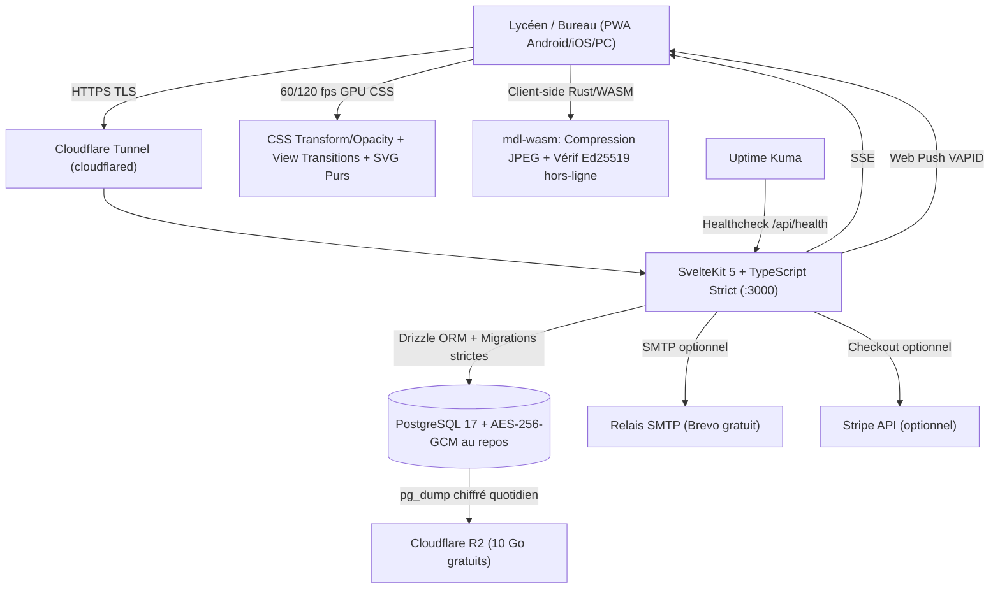

# PHASE 0 — Cadrage, Décisions Validées & Architecture Verrouillée

## 1. Décisions Cadrage Validées (Réponses Utilisateur)

1. **Inscription des lycéens** : Inscription ouverte avec code d'accès lycée optionnel configurable depuis l'administration.
2. **Système hôte** : Linux (Ubuntu / Debian / Arch) avec Docker Compose (`PostgreSQL 17`, `App`, `Backup`, `Cloudflared`, `Uptime Kuma`).
3. **RGPD mineurs (15-18 ans)** : Consentement éclairé simplifié en français clair + champ optionnel pour l'email/accord du responsable légal.
4. **Paiements billetterie & adhésions** : Mode « espèces / virement à l'entrée » obligatoire (budget zéro) + module Stripe Checkout désactivé par défaut et activable via `.env`.
5. **Emails (liens magiques, convocations, billets)** : Mode hybride 100 % fonctionnel sans SMTP (QR codes & PDF générés et téléchargeables directement dans l'interface) + relais SMTP (ex. Brevo gratuit) activable via `.env`.

## 2. Synthèse Product Manager (MoSCoW)

- **Produit** : **MDL Connect** — PWA ultra-légère, fluide à 60/120 fps sur Android d'entrée de gamme, auto-hébergée pour une Maison des Lycéens (~1 000 élèves, ~30 membres du bureau + professeur référent).
- **MUST** : Auth Argon2id + cookies `httpOnly`/`SameSite=Strict` + 2FA TOTP + RBAC strict (7 rôles), Membres & Adhésions, Projets (11 modèles, Kanban, compte à rebours J-x, sécurité), Budget + justificatifs compressés côté client en Rust/WASM + graphiques SVG purs + export CSV/PDF, AG & Élections (candidatures QR, vote salle/en ligne, dépouillement, PV PDF officiel, audit log chaîné SHA-256), Sondages temps réel (SSE), Billetterie (QR signés **Ed25519** vérifiés **hors-ligne en Rust/WASM**, espèces/virement + Stripe optionnel), Passation & Coffre-fort chiffré AES-256-GCM, Bilans Parcoursup PDF, PWA installable + Web Push VAPID, Mini-site public personnalisable, RGPD mineurs, PostgreSQL 17 + Drizzle ORM + migrations strictes, Docker Compose + Cloudflare Tunnel + sauvegardes chiffrées R2 + documentation débutant.
- **WON'T** : WebGPU/WebGL2 (remplacé par CSS `transform`/`opacity`, View Transitions et SVG purs pour 60/120 fps sans drain batterie), trackers tiers, publicité.

## 3. Architecture Verrouillée

## 4. Plan d'Exécution (Phases 1 à 11 — Lots de 3 à 4 fichiers max par message)

- **PHASE 1** — Architecture + Design System (CSS/View Transitions + SVG) + Rust/WASM (`compress_receipt_image` + `verify_ticket_ed25519`) + Squelette monorepo & Schéma PostgreSQL 17 Drizzle.
- **PHASE 2** — Auth Argon2id, cookies httpOnly/SameSite Strict, 2FA TOTP, RBAC 7 rôles, membres, adhésions, audit log chaîné.
- **PHASE 3** — Projets (11 modèles, Kanban, calendrier, J-x) + Budget & justificatifs WASM + graphiques SVG purs.
- **PHASE 4** — AG & Élections (candidatures QR, convocations/émargement/PV PDF, vote salle & en ligne, anonymisation).
- **PHASE 5** — Sondages temps réel (SSE) + QR.
- **PHASE 6** — Billetterie (signature Ed25519, espèces/virement + Stripe optionnel, compteur SSE, scanner QR PWA hors-ligne Ed25519).
- **PHASE 7** — Passation, coffre-fort chiffré, bilans Parcoursup PDF.
- **PHASE 8** — PWA complète (offline, installable A2HS, Web Push VAPID).
- **PHASE 9** — Intégration finale & vérification Rust/WASM + animations 60/120 fps.
- **PHASE 10** — Tests Vitest, E2E Playwright, Lighthouse CI (≥ 95), audit sécurité ASVS L1.
- **PHASE 11** — Docker Compose PostgreSQL 17, Cloudflare Tunnel + WAF, sauvegardes R2 + restauration 30 min, monitoring, documentation débutant.
